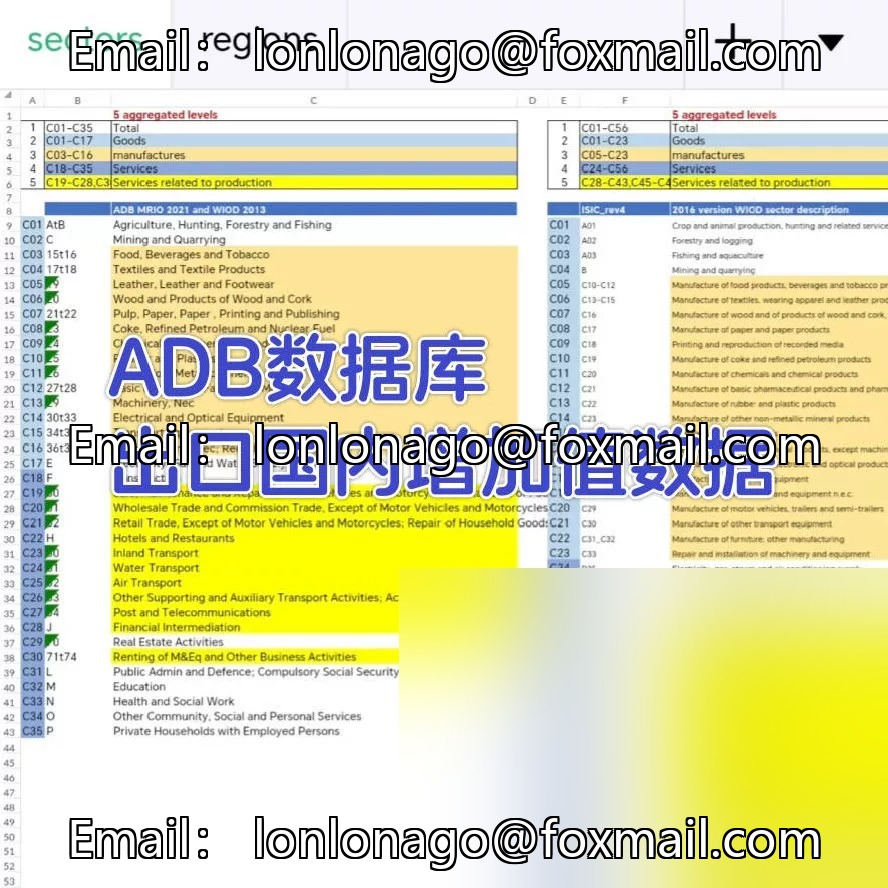
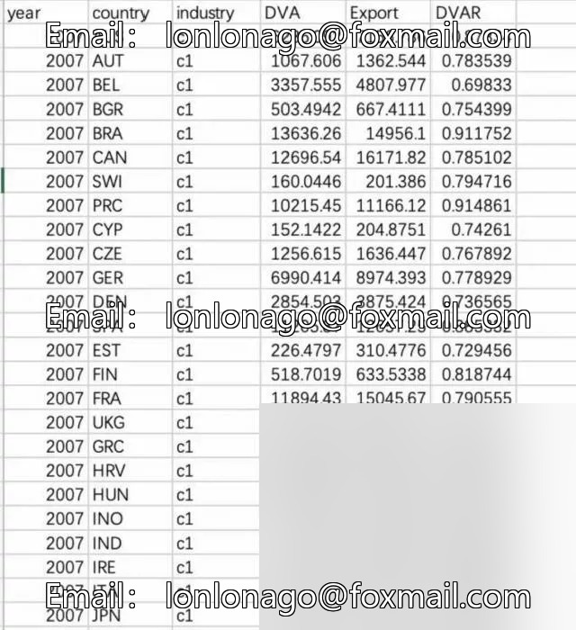
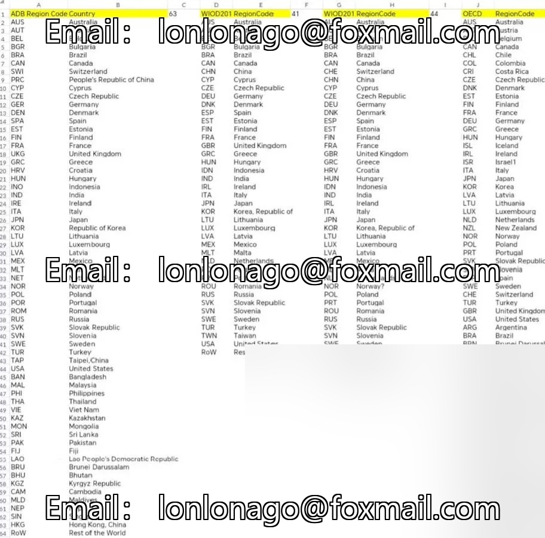

# ADB database - export domestic added value data, including 35 countries or regions from 63

## Body

ADB database - Export domestic added value data, including 35 subdivisions of 63 countries or regions
ADB database - Export domestic added value data, including 35 subdivisions of 63 countries or regions

Data content:
1. Export domestic value added (DVA)
2. Export domestic value added rate (DVAR)
3. Export amount

Time range: 2007-2022.  
Data on export domestic added value, export value, and export domestic added value rate for each subdivided industry.

Data source: ADB input-output table metric calculation data

web-based shipment, can be directly photographed and shipped.

The data covers 63 countries and 35 sub-sectors, including export domestic value added, export domestic value added rate and export amount, covering the years 2007-2022.

<!-- AI_ENRICHED -->

## Images

## Payment

Here is a pay link on Stripe ( https://buy.stripe.com/3cs8yP7sY87d0vu9AB ). Please contact me lonlonago@foxmail.com after funding $89, and I will send you a complete data files , thank you!

